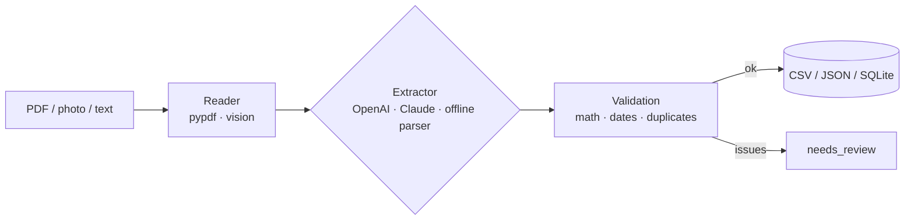

# Invoice & Receipt Extractor

Drop a folder of invoices (PDF, photos, scans, text) and get clean, validated data in CSV, JSON or SQLite, ready for accounting or a Google Sheet. Anything suspicious is flagged for review instead of silently slipping into your books.

**Problem it solves:** someone in the team spends hours every month retyping supplier invoices into a spreadsheet, and mistakes (wrong totals, double-paid invoices) are only caught later. This tool does the typing and the checking.



## Features

- **Structured extraction**: vendor, invoice number, dates, currency, subtotal, tax, total, line items
- **LLM providers**: OpenAI and Claude, including **vision for phone photos and scanned receipts**
- **Offline mode**: a rule-based parser for digital PDFs that runs with no API key, so you can try it in 10 seconds
- **Schema-validated output** with Pydantic; invalid model output is sent back for self-correction (up to 3 attempts)
- **Business-rule validation**:
  - qty × unit price = line amount
  - line items add up to subtotal, subtotal + tax = total
  - missing invoice number or date, future dates, due date before invoice date
  - **duplicate invoices** (same vendor + number), the classic double-payment problem
- Handles US and EU number formats (`1,234.56` / `1.234,56`) and common date formats
- Parallel processing; one bad file never stops the batch
- Exports: `invoices.csv` + `line_items.csv`, `invoices.json`, `invoices.db` (SQLite)

## Quick start (no API keys needed)

```bash
pip install -r requirements-dev.txt
python -m extractor samples/ --format csv json sqlite
```

Output:

```
Provider: mock · 5 files

✅ acme_cloud_2026-10.pdf       Acme Cloud Services Inc. INV-2026-1042      432.30 USD
⚠️  acme_cloud_resent.txt        Acme Cloud Services Inc. INV-2026-1042      432.30 USD
     └ invoice_number: duplicate of acme_cloud_2026-10.pdf
✅ berlin_design_studio.pdf     Berlin Design Studio Gmb BDS-0877          2142.00 EUR
✅ coffee_receipt.txt           Kava Lab Kyiv            004417             240.00 UAH
⚠️  office_supplies_error.pdf    OfficeHub Ltd            OH-55120           510.00 GBP
     └ line_items[2]: 2 × 180.00 = 360.00, invoice says 380.00

3/5 ready for accounting, 2 need review
Saved: output/invoices.csv, output/line_items.csv, output/invoices.json, output/invoices.db
```

The sample set intentionally contains a **calculation error** and a **re-sent duplicate** to show the validation layer.

## Photos and scans (LLM mode)

```bash
cp .env.example .env     # set LLM_PROVIDER=openai and OPENAI_API_KEY
python -m extractor ~/Downloads/receipts/ --format csv
```

## Docker

```bash
docker build -t invoice-extractor .
docker run --rm -v "$PWD/output:/app/output" invoice-extractor
```

## Project structure

```
extractor/
  models.py       Invoice / LineItem / result schemas
  readers.py      PDF, text and image input
  providers.py    offline parser + OpenAI / Claude (text & vision) with retry
  validation.py   math, date and duplicate checks
  exporters.py    CSV, JSON, SQLite
  pipeline.py     parallel batch processing
samples/          demo invoices (regenerate with scripts/make_samples.py)
tests/            pytest suite
```

## Tests

```bash
pytest -q
```

## Ideas for extension

Watch a Gmail label or Google Drive folder and process new invoices automatically · push results to Google Sheets, QuickBooks or Xero · Telegram message for every `needs_review` invoice.

## Stack

Python 3.12 · Pydantic v2 · pypdf · OpenAI / Anthropic SDK (vision) · SQLite · Docker

---

Built by [Olesia Tkachenko](https://lessiatk.github.io) — Python & AI automation. Need something similar? [Get in touch](mailto:olesiatkachenko211@gmail.com).
